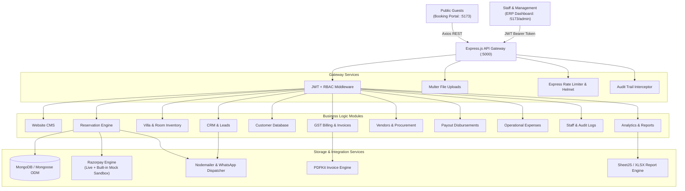

# 🌙 MOON LIGHT VILLA – Luxury Villa Reservation Website & Complete ERP Management System

A production-ready, enterprise-grade hospitality solution engineered for **MOON LIGHT VILLA** (Lonavala, Maharashtra). The platform bridges two interconnected applications sharing a unified Node.js/Express REST backend and MongoDB database:
1. **Public-Facing Luxury Villa Reservation Portal** – High-conversion booking portal with live inventory checks, seasonal pricing, coupon validations, Razorpay payment gateway integration, and instant PDF vouchers.
2. **Private Villa Management ERP System** – Full-scale back-office administration covering 11 integrated modules with role-based access control (RBAC), multi-level approval workflows, financial accounting, and automated exports.

---

## 🏛️ System Architecture



---

## 🛠️ Technology Stack

### Frontend Application
- **Framework & Tooling:** React 18, Vite, React Router DOM v7
- **Styling & UI:** Tailwind CSS, Lucide React Icons, Playfair Display & Plus Jakarta Sans typography
- **State & Data Fetching:** Axios with HTTP interceptors, React Context API, React Hook Form
- **Analytics & Visualizations:** Recharts (Interactive Area Charts, Donut/Pie Charts)
- **Export Utility:** SheetJS (`xlsx`) for client-side tabular downloads

### Backend Application
- **Runtime & Framework:** Node.js (ES Modules), Express.js
- **Database & ODM:** MongoDB with Mongoose ODM (includes embedded `mongodb-memory-server` fallback for zero-configuration instant local development)
- **Security & Headers:** JSON Web Tokens (JWT), bcryptjs, Helmet, CORS, Express Rate Limit
- **File Storage:** Multer for local media & document uploads
- **Documents & Reporting:** PDFKit for dynamic vector-grade tax invoices and vouchers, `xlsx` for Excel spreadsheets
- **Integrations:** Razorpay SDK, Nodemailer SMTP, Simulated WhatsApp notification engine

---

## 📂 Project Directory Structure

```text
moon-light/
├── package.json               # Root scripts (install:all, dev, seed, start)
├── .env.example               # Complete environment variable template
├── README.md                  # Comprehensive technical documentation
│
├── backend/                   # Node.js + Express REST API Server
│   ├── config/
│   │   └── db.js              # Resilient MongoDB connector (Native + Memory Server fallback)
│   ├── controllers/           # REST business logic controllers
│   │   ├── authController.js
│   │   ├── billingController.js
│   │   ├── crmController.js
│   │   ├── customerController.js
│   │   ├── financeController.js
│   │   ├── reportController.js
│   │   ├── reservationController.js
│   │   ├── villaController.js
│   │   └── websiteController.js
│   ├── middleware/
│   │   ├── auth.js            # JWT verification & RBAC authorization
│   │   ├── errorHandler.js    # Standardized JSON error response handler
│   │   └── upload.js          # Multer storage configuration
│   ├── models/                # Mongoose database schemas
│   │   ├── Billing.js         # Invoice, Payment, Refund
│   │   ├── CRM.js             # Lead, FollowUp, Quotation
│   │   ├── Customer.js        # Customer master profiles
│   │   ├── Finance.js         # Vendor, VendorBill, Payout, Expense, ExpenseCategory
│   │   ├── Reservation.js     # Reservation, Coupon
│   │   ├── System.js          # Notification, AuditLog
│   │   ├── User.js            # User, Role, Permission
│   │   ├── Villa.js           # Villa, RoomCategory, Room, PricingRule, AvailabilityBlock
│   │   └── Website.js         # WebsiteSettings, Banner, GalleryItem, Testimonial, SpecialOffer
│   ├── routes/                # Express API route declarations
│   ├── services/              # External service integrations
│   │   ├── excelService.js    # Multi-tab and single-tab Excel workbook generator
│   │   ├── notificationService.js # Nodemailer email & WhatsApp notifier
│   │   ├── paymentService.js  # Razorpay order creator & signature verifier (with sandbox fallback)
│   │   └── pdfService.js      # Streaming PDF invoice generator
│   ├── uploads/               # Uploaded images, receipts, and proofs
│   ├── utils/
│   │   └── seed.js            # Rich, realistic initial luxury villa seed dataset
│   └── server.js              # Application entrypoint & middleware orchestrator
│
└── frontend/                  # React + Vite Single Page Application
    ├── public/
    ├── src/
    │   ├── assets/            # Static media and branding
    │   ├── context/
    │   │   └── AuthContext.jsx # Global authentication, session, and role state
    │   ├── layouts/
    │   │   ├── AdminLayout.jsx # ERP sidebar navigation, topbar, notifications, user profile
    │   │   └── PublicLayout.jsx # Luxury navigation, sticky booking header, footer
    │   ├── modules/           # 11 Dedicated ERP Modules
    │   │   ├── BillingManagement.jsx
    │   │   ├── CRMManagement.jsx
    │   │   ├── CustomerManagement.jsx
    │   │   ├── ExpenseManagement.jsx
    │   │   ├── PayoutManagement.jsx
    │   │   ├── ReportsManagement.jsx
    │   │   ├── ReservationManagement.jsx
    │   │   ├── StaffManagement.jsx
    │   │   ├── VendorManagement.jsx
    │   │   ├── VillaRoomManagement.jsx
    │   │   └── WebsiteManagement.jsx
    │   ├── pages/
    │   │   ├── admin/         # ERP Dashboard & Login
    │   │   │   ├── DashboardPage.jsx
    │   │   │   └── LoginPage.jsx
    │   │   └── public/        # Public Portal Pages
    │   │       ├── AboutPage.jsx
    │   │       ├── BookingConfirmationPage.jsx
    │   │       ├── BookingPage.jsx
    │   │       ├── ContactPage.jsx
    │   │       ├── GalleryPage.jsx
    │   │       ├── HomePage.jsx
    │   │       ├── TermsPrivacyPage.jsx
    │   │       ├── VillaDetailPage.jsx
    │   │       └── VillasPage.jsx
    │   ├── routes/
    │   │   └── AppRoutes.jsx  # Public and protected ERP route mappings
    │   ├── services/
    │   │   └── api.js         # Axios instance with auth interceptors
    │   ├── App.jsx
    │   ├── index.css
    │   └── main.jsx
    ├── tailwind.config.js
    └── vite.config.js
```

---

## 🌟 Key Functional Modules & Features

### 1. Public Luxury Villa Reservation Portal
- **Hero & Live Availability Search:** Date range picker with adult and children guest selector querying real-time available inventory.
- **Villa & Room Showcase:** High-resolution galleries, amenities breakdown, room capacity, and seasonal pricing tiers.
- **Dynamic Pricing Engine:** Automatic calculation of nights, base rate, extra guest charges, weekend adjustments, coupon code discounts, 18% GST (CGST 9% + SGST 9%), refundable security deposit, and required 50% advance.
- **Coupon System:** Active promo codes (e.g., `WELCOME10` for 10% off up to ₹10,000) verified against minimum spend and date restrictions.
- **Razorpay Checkout:** Supports both live Razorpay gateway credentials and an automated built-in sandbox mock payment engine for frictionless testing without API keys.
- **Booking Confirmation & Voucher:** Reference number generator (`MLV-XXXXX`), instant printable voucher, and direct tax invoice PDF download.

### 2. Complete ERP Administration System (11 Functional Modules)
- **Executive Dashboard:** Dynamic multi-location switcher, 14 live KPI cards (Total Revenue, Today's Bookings, Total Reservations, Confirmed, Pending, Cancelled, Total Leads, Converted Leads, Total Inventory of 120 Rooms, Occupied Rooms, Available Rooms, Cleaning / Housekeeping, Maintenance Blocked, Net Profit, Pending Payments), Recharts Revenue Trend Area Chart, Booking Source Pie Chart, and Recent Reservations table.
- **Module 1: Website Management (CMS):** Edit homepage banners, about story, villa copy, gallery items, amenities, testimonials, special offers, promo coupons, contact coordinates, and SEO meta tags.
- **Module 2: Reservation Management:** Real-time multi-status calendar, manual booking creation, booking status lifecycle (`Enquiry` → `Pending` → `Confirmed` → `Checked-in` → `Checked-out` → `Cancelled` → `Refunded`), balance collection modal, and double-booking prevention.
- **Module 3: Multi-Location Properties & 120-Room Inventory:**
  - **Multi-Location Management:** Manage multiple luxury resort branches (e.g. *Lonavala Hills - 60 Rooms*, *North Goa Beachfront - 30 Rooms*, *Alibaug Coastal Palms - 30 Rooms*), property managers, addresses, contact details, and occupancy analytics.
  - **120-Room Visual Rack (Interactive Matrix):** Real-time front-desk rack view color-coded by operational status: 🟢 *Available (Clean)*, 🔴 *Occupied*, 🟡 *Cleaning (Housekeeping)*, 🟣 *Maintenance Locked*, 🔵 *Reserved*.
  - **1-Click Quick Status Toggler:** Instant status updates directly from visual room cards without navigating away.
  - **⚡ Bulk Room Generator:** Rapidly provision sequences of rooms (e.g., 101 to 130) with wing, floor, category, and pricing parameters in seconds.
  - **Maintenance Blocks:** Establish room-level or villa-level maintenance locks that automatically reflect on availability calendars.
- **Module 4: CRM & Lead Management:** Inbound website inquiry capture, manual lead entry, sales pipeline stages (`New` → `Contacted` → `Follow-up` → `Interested` → `Quotation Sent` → `Converted` → `Lost`), follow-up reminders, quotation generator, and 1-click lead conversion to customer.
- **Module 5: Customer Management:** Customer profiles, stay history, lifetime revenue spend, Aadhaar/Passport ID records, VIP guest badges, and notes.
- **Module 6: Billing & Invoices:** Automatic invoice generation on booking confirmation, manual invoice creation, 18% GST calculation (9% CGST + 9% SGST), advance receipts, and streaming PDF invoices powered by PDFKit.
- **Module 7: Vendor Management:** Vendor directory (laundry, catering, maintenance, landscaping), bills tracking, payment status (`Unpaid`, `Partially Paid`, `Paid`), and outstanding balances.
- **Module 8: Payout Management:** Multi-party disbursements (Owner payouts, vendor settlements, staff incentives), approval workflow (`Pending` → `Approved` → `Paid`), payment reference numbers, and receipt proof attachments.
- **Module 9: Expense Tracking:** Categorized operational expenses (Electricity, Water, Housekeeping supplies, Food & Beverage, Repairs), payment modes, bill attachments, and monthly expense aggregations.
- **Module 10: Staff & Role Management:** Comprehensive RBAC supporting 7 roles (`Super Admin`, `Administrator`, `Manager`, `Receptionist`, `Sales Executive`, `Accountant`, `Housekeeping Staff`), active/inactive toggles, and compliance audit trail logging every administrative operation.
- **Module 11: Reports & Analytics:** Centralized report generator across 7 domains (Revenue, Bookings, Occupancy, Leads, Expenses, Invoices, Payouts) with date range filters (`Today`, `This Month`, `Custom Range`) and 1-click Excel export.

---

## 🔒 Security & Data Integrity

1. **Authentication:** Stateless JSON Web Tokens (JWT) signed with HMAC-SHA256 and stored securely in client memory/local storage with automatic bearer authorization headers.
2. **Password Security:** Passwords salted and hashed with `bcryptjs` (salt rounds: 10).
3. **Double Booking Prevention:** Reservation controller utilizes compound date-overlap queries (`checkIn < newCheckOut` AND `checkOut > newCheckIn`) across active bookings (`Confirmed`, `Checked-in`, `Pending`) and maintenance blocks.
4. **Audit Trail:** Every mutating request (create, update, delete, status transition) records the acting user, role, IP address, and payload snapshot in the `auditlogs` collection.
5. **Security Headers & Rate Limiting:** `helmet` disables harmful browser exploits, CORS is locked to authorized origins, and `express-rate-limit` prevents brute-force abuse.

---

## 🚀 Getting Started & Local Installation

### Prerequisites
- **Node.js:** v18.0.0 or higher
- **npm:** v9.0.0 or higher
- **MongoDB:** *(Optional)* Local MongoDB on `mongodb://127.0.0.1:27017` or MongoDB Atlas URI. **If no MongoDB server is detected, the application automatically launches an embedded memory server for instantaneous zero-config testing!**

### Step 1: Clone & Install Dependencies

From the project root:

```bash
# Install root, backend, and frontend packages in one command
npm run install:all
```

### Step 2: Configure Environment Variables

The project comes with a preconfigured template. Copy `.env.example` to `backend/.env`:

```bash
cp .env.example backend/.env
```

Key environment configuration parameters:
```env
PORT=5000
NODE_ENV=development
MONGODB_URI=mongodb://127.0.0.1:27017/moon_light_villa
JWT_SECRET=moon_light_villa_super_secret_jwt_key_2026_xyz

# External Service Keys (Leave empty to use built-in mock/simulation engines)
RAZORPAY_KEY_ID=
RAZORPAY_KEY_SECRET=
EMAIL_HOST=
EMAIL_PORT=587
EMAIL_USER=
EMAIL_PASS=
WHATSAPP_API_URL=
WHATSAPP_API_TOKEN=
```

### Step 3: Run the Development Server

Start both the Backend REST API and Frontend Vite dev server concurrently:

```bash
npm run dev
```

- **Public Website:** `http://localhost:5173`
- **Admin ERP Login:** `http://localhost:5173/admin/login`
- **Backend API:** `http://localhost:5000`
- **API Health Check:** `http://localhost:5000/api/health`

---

## 🔑 Default Test Credentials

The database seeds automatically on first launch with role-differentiated accounts (Password for all: `password123`):

| Role | Email Address | Password | Module Access |
| :--- | :--- | :--- | :--- |
| **Super Admin** | `admin@moonlightvilla.com` | `password123` | Full access to all 11 modules, settings & staff |
| **Manager** | `manager@moonlightvilla.com` | `password123` | Reservations, Inventory, CRM, Billing, Reports |
| **Sales Executive** | `sales@moonlightvilla.com` | `password123` | Leads CRM, Customer Profiles, Reservations |
| **Accountant** | `accounts@moonlightvilla.com` | `password123` | Invoices, Vendor Bills, Payouts, Expenses, Reports |

*(1-click login buttons are also built directly into the ERP login screen for instant testing).*

---

## 📡 REST API Reference Summary

### Authentication & Staff
| Method | Endpoint | Description | Access |
| :--- | :--- | :--- | :--- |
| `POST` | `/api/auth/login` | Staff authentication & JWT issuance | Public |
| `GET` | `/api/auth/profile` | Get current user profile | Authenticated |
| `GET` | `/api/auth/users` | List all staff members | Admin/Manager |
| `POST` | `/api/auth/users` | Create new staff user | Super Admin |
| `GET` | `/api/auth/roles` | Retrieve available RBAC roles | Authenticated |
| `GET` | `/api/auth/audit-logs`| View system compliance audit logs | Super Admin |

### Villas, Rooms & Availability
| Method | Endpoint | Description | Access |
| :--- | :--- | :--- | :--- |
| `GET` | `/api/villas` | List all villas | Public |
| `GET` | `/api/villas/:id` | Get individual villa specifications | Public |
| `POST` | `/api/villas` | Create new villa record | Admin |
| `GET` | `/api/villas/:id/rooms`| List rooms assigned to a villa | Public |
| `POST` | `/api/villas/check-availability` | Check date range inventory availability | Public |
| `POST` | `/api/villas/calculate-price` | Compute real-time pricing with taxes & coupon | Public |
| `POST` | `/api/villas/maintenance-block` | Add room maintenance lock | Admin/Manager |

### Reservations & Checkout
| Method | Endpoint | Description | Access |
| :--- | :--- | :--- | :--- |
| `GET` | `/api/reservations` | List all reservations with filters | Staff |
| `POST` | `/api/reservations` | Create reservation (Online or Manual) | Public / Staff |
| `GET` | `/api/reservations/:id`| Get full reservation details | Staff |
| `GET` | `/api/reservations/reference/:ref`| Public voucher lookup by reference | Public |
| `PATCH` | `/api/reservations/:id/status`| Update reservation status & audit | Staff |
| `POST` | `/api/reservations/:id/payment`| Record manual advance or balance payment | Staff |
| `POST` | `/api/reservations/validate-coupon`| Check coupon code validity | Public |
| `POST` | `/api/reservations/create-payment-order`| Create Razorpay payment order | Public |
| `POST` | `/api/reservations/verify-payment`| Verify payment signature & confirm booking | Public |

### CRM & Customer Management
| Method | Endpoint | Description | Access |
| :--- | :--- | :--- | :--- |
| `GET` | `/api/crm/leads` | List leads with status filters | Sales/Admin |
| `POST` | `/api/crm/leads` | Create lead (inbound website or manual) | Public / Staff |
| `PATCH` | `/api/crm/leads/:id` | Update lead status or sales owner | Staff |
| `POST` | `/api/crm/leads/:id/follow-up` | Record follow-up interaction | Staff |
| `POST` | `/api/crm/leads/:id/convert`| Convert lead to verified customer | Staff |
| `GET` | `/api/customers` | Query customer database & lifetime spend | Staff |
| `GET` | `/api/customers/:id` | Get customer profile & stay history | Staff |

### Billing, Finance & Reports
| Method | Endpoint | Description | Access |
| :--- | :--- | :--- | :--- |
| `GET` | `/api/billing/invoices` | List GST invoices | Accounts/Admin |
| `POST` | `/api/billing/invoices` | Generate new tax invoice | Accounts/Admin |
| `GET` | `/api/billing/invoices/:id/pdf` | Stream generated PDF tax invoice | Staff / Guest |
| `GET` | `/api/finance/vendors` | List suppliers & vendor balances | Accounts/Admin |
| `POST` | `/api/finance/vendor-bills` | Create vendor invoice | Accounts/Admin |
| `GET` | `/api/finance/payouts` | List disbursements & approvals | Accounts/Admin |
| `POST` | `/api/finance/payouts/:id/approve` | Approve payout request | Admin |
| `GET` | `/api/finance/expenses` | List categorized operational expenses | Accounts/Admin |
| `POST` | `/api/finance/expenses` | Record operational expense voucher | Accounts/Admin |
| `GET` | `/api/reports/analytics` | Retrieve metrics across any date range | Staff |
| `GET` | `/api/reports/export-excel` | Download multi-sheet Excel workbook | Staff |

---

## 🧪 Testing & Verification

The application includes end-to-end integration test routines covering:
1. **Authentication & RBAC:** Verification of JWT generation, role-permission guards, and password hashing.
2. **Double-Booking Collision Prevention:** Ensuring concurrent bookings for overlapping dates on the same villa/room are blocked with HTTP 400 conflict errors.
3. **Discount & Financial Calculations:** Verifying GST percentage splits (9% CGST + 9% SGST), coupon discounts, advance payment amounts, and balance due.
4. **Payment Gateway Flow:** Razorpay order generation, signature verification, and automated transition from `Pending` to `Confirmed`.
5. **Invoice & Report Generation:** Dynamic vector PDF generation and Excel binary export.

To run the automated verification script:
```bash
node -e '
const axios = require("axios");
async function test() {
  const login = await axios.post("http://localhost:5000/api/auth/login", {
    email: "admin@moonlightvilla.com",
    password: "password123"
  });
  console.log("✓ Admin Login:", login.data.user.fullName);
  const health = await axios.get("http://localhost:5000/api/health");
  console.log("✓ API Health:", health.data.system);
}
test().catch(console.error);
'
```

---

## 🚢 Deployment Guide

### Production Build
1. Build the React frontend:
   ```bash
   cd frontend
   npm run build
   ```
2. Serve the built assets either via Nginx, AWS S3/CloudFront, or have Express serve the static `frontend/dist` directory in production mode.
3. Configure your production environment variables in `backend/.env` with your real MongoDB Atlas connection string and production Razorpay API keys.
4. Run the backend using a process manager such as PM2:
   ```bash
   pm2 start backend/server.js --name "moon-light-villa-api"
   ```

---

## 📄 License & Attribution
Proprietary software developed for **MOON LIGHT VILLA**. All rights reserved.
